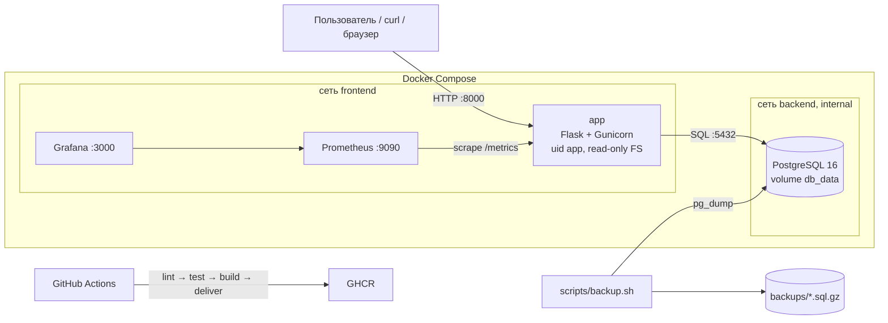

# Информационная система управления библиотекой

СРО №15 «Комплексное применение инструментов DevOps в информационных системах», вариант 1.
Дисциплина «Прикладные аспекты DevOps».

Система ведёт учёт книг, читателей и выдачи литературы. Она работает через REST API и развёрнута
в Docker-контейнерах. В проекте настроены CI/CD, мониторинг, резервное копирование и базовая защита конфигурации.

## Архитектура



| Компонент | Технология | Назначение |
|---|---|---|
| app | Python 3.12, Flask, Gunicorn | REST API, бизнес-логика, логи в JSON, `/health`, `/metrics` |
| db | PostgreSQL 16 | Хранение книг, читателей и выдач (том `db_data`) |
| prometheus, grafana | профиль `monitoring` | Сбор метрик, оповещения, дашборд |
| scripts/ | Bash | Запуск, остановка, мониторинг, бэкап, восстановление, проверка безопасности |
| .github/workflows | GitHub Actions | CI/CD-конвейер |

## Быстрый старт

```bash
git clone https://github.com/<user>/library-devops.git && cd library-devops
cp .env.example .env          # задайте свои пароли
./scripts/start.sh            # или ./scripts/start.sh --monitoring
./scripts/seed.sh             # тестовые данные
curl http://localhost:8000/api/books
```

Grafana: http://localhost:3000 (дашборд «Library IS»), Prometheus: http://localhost:9090.

## API

| Метод | URL | Описание |
|---|---|---|
| GET | `/api/books?q=&author=&available=true` | Поиск и фильтрация книг |
| POST | `/api/books` | Добавить книгу `{title, author, isbn?, year?, copies?}` |
| GET / DELETE | `/api/books/<id>` | Получить или удалить книгу |
| GET / POST | `/api/readers` | Список читателей / регистрация `{full_name, email, phone?}` |
| GET / POST | `/api/loans?open=true&overdue=true` | Выдачи / выдать книгу `{book_id, reader_id, days?}` |
| POST | `/api/loans/<id>/return` | Возврат книги |
| GET | `/api/stats` | Статистика |
| GET | `/health` | Проверка состояния (200 или 503) |
| GET | `/metrics` | Метрики Prometheus |

Бизнес-правила:
- выдать можно только книгу, у которой есть свободный экземпляр;
- на руках у читателя одновременно не больше 5 книг;
- одну и ту же книгу нельзя выдать одному читателю дважды;
- срок выдачи от 1 до 60 дней;
- ISBN и e-mail читателя уникальны;
- выданную книгу нельзя удалить.

## Управление инфраструктурой

| Команда | Make | Что делает |
|---|---|---|
| `./scripts/start.sh [--monitoring]` | `make up` | Сборка, запуск, ожидание готовности |
| `./scripts/stop.sh [--purge]` | `make down` | Остановка (данные сохраняются) |
| `./scripts/status.sh` | `make status` | `docker compose ps`, health, `docker stats` |
| `./scripts/analyze_logs.sh [1h]` | `make analyze` | Анализ JSON-логов: уровни, статусы, ошибки, медленные запросы |
| `./scripts/backup.sh` | `make backup` | `pg_dump` → `backups/*.sql.gz`, SHA-256, ротация |
| `./scripts/restore.sh [файл] [--production]` | `make restore` | Восстановление в тестовую БД и сверка данных |
| `./scripts/simulate_failure.sh` | `make failure` | Имитация отказа БД и проверка восстановления |
| `./scripts/smoke_test.sh` | `make smoke` | Проверка работающей системы |
| `./scripts/security_check.sh` | `make security` | Проверка секретов, пользователя, прав, портов |

## Тестирование

```bash
pip install -r requirements-dev.txt
python -m pytest -v --cov=app       # SQLite
TEST_DATABASE_URL=postgresql://... python -m pytest   # PostgreSQL
```

31 автотест покрывает добавление и поиск книг, валидацию, выдачу и возврат, бизнес-правила,
`/health` при отказе БД и формат метрик.

## CI/CD

Файл `.github/workflows/ci-cd.yml` запускается при push в `main` или `develop`, а также при pull request:

1. **lint**: flake8.
2. **test**: pytest на PostgreSQL (service container) и на SQLite, отчёт о покрытии.
3. **build**: `docker compose up`, smoke-тест, бэкап и восстановление, имитация отказа, проверка безопасности, Trivy.
4. **deliver** (только `main`): публикация образа в GitHub Container Registry.

## Безопасность

- Секреты лежат только в `.env`, а `.env` указан в `.gitignore`. В репозитории есть только `.env.example`.
- Контейнер работает от непривилегированного пользователя `app`, с read-only файловой системой.
  Включены `cap_drop: ALL` и `no-new-privileges`, заданы лимиты CPU и памяти.
- БД находится во внутренней сети `backend`, и её порт наружу не публикуется.
- Логи ротируются: максимум 3 файла по 10 МБ. У резервных копий права 600.
- В системе используются только вымышленные тестовые данные.
